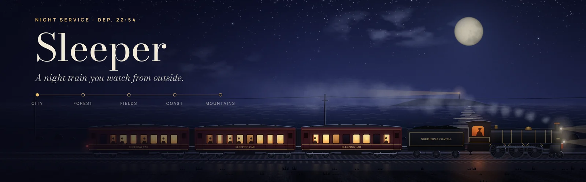

  

<a href="https://bytiagodev.github.io/sleeper/?journey=4242"><strong>Ride journey 4242</strong></a>

---

A steam train pulls out of a country station at night, crosses a world that is built as it goes, stops at the next platform and disappears into a tunnel. You watch it from the side of the line. Every picture and every sound in it is made by code, and the page loads no image or audio files at all.

The link above is journey 4242, and it is the same ride for anyone who opens it: the same landscapes, weather, train, stations and passengers. Every journey is a single number like that. **Share** copies the one you are on as a link, and **New journey** picks another.

The line never ends. It runs through city, forest, fields, coast and mountains, two to four landscapes at a time, and carries on into new ones when a run is over, so a long night never repeats. The weather is clear, rain, snow or fog, and each has its own air: a far ridge stays sharp on a clear night, while a tree 150 metres away is half gone in fog. Half the landscapes have a station, with a brick building, a clock set to the departure time and a signal that drops to green when it is time to go. The train brakes to stop exactly on its mark, passengers get on and off and compartments light up or go dark. Each landscape ends at a grassy hill with a stone tunnel mouth. The train runs into the arch, its smoke rolls back out over the stone, and the next landscape is built in the dark while it is inside.

Everything is measured in metres. The camera stands 12 metres from the track and 6 metres up, and something twice as far away is drawn half as big and slides past half as fast. No tree, pole or building has a size on screen or a speed picked by hand, only a size in metres and a distance. The fence posts, railings, sea walls, ferns and boulders that pass in front of the line sit just under the camera's view of the rails, so they frame the train instead of covering it. A station has thousands of bricks and a tunnel mouth hundreds of stones, so each is drawn once into its own image when it is created, and every frame only places that image at its distance.

**Sound** turns on the chuffs, the rail joints, the brakes, the doors and the whistle. Filtered noise becomes wind, rain, steam or a knock, and oscillators make the whistle and the brake squeal. A compressor keeps the mix calm, and the rest of the train steps back while the whistle blows. Inside a tunnel the train sounds muffled from outside, then echoes all around once the camera follows it in. The same panel has a sleep timer that fades the sound and darkens the screen after 15 minutes, half an hour or an hour, while the train carries on.

## Running it

Open `index.html` in a browser. The code is plain JavaScript, one file per part of the scene under `js/`, loaded in order by the page.

Two promises have tests in `test/`, which need nothing but Node: that a journey is a single number, and that distance alone decides how big and how fast anything is drawn. Run `node --test`. They also run on every push.

---

  Code under the <a href="LICENSE">MIT licence</a> · Built by <a href="https://bytiago.com/en/">Tiago Teixeira</a>

